# pele/ascii gallery

Every diagram type, drawn by `renderAscii(source, { maxWidth: 100 })`. The examples come from Mermaid's documentation. Regenerate this file with `npm run build && node scripts/ascii-gallery.mjs`.

|  |  |  |  |
| --- | --- | --- | --- |
| [Agent flow](#agent-flow) | [Architecture](#architecture) | [Block](#block) | [C4](#c4) |
| [Class](#class) | [Cynefin](#cynefin) | [Entity relationship](#entity-relationship) | [Event modeling](#event-modeling) |
| [Flowchart](#flowchart) | [Gantt](#gantt) | [Git graph](#git-graph) | [Ishikawa](#ishikawa) |
| [User journey](#user-journey) | [Kanban](#kanban) | [Mindmap](#mindmap) | [Packet](#packet) |
| [Pie](#pie) | [Quadrant chart](#quadrant-chart) | [Radar](#radar) | [Railroad](#railroad) |
| [Requirement](#requirement) | [Sankey](#sankey) | [Sequence](#sequence) | [State](#state) |
| [Swimlane](#swimlane) | [Timeline](#timeline) | [Treemap](#treemap) | [Tree view](#tree-view) |
| [Use case](#use-case) | [Venn](#venn) | [Wardley map](#wardley-map) | [XY chart](#xy-chart) |

## Agent flow

```text
                  ╱───────────────╱
                  │ Release brief │
                  ╱───────┬───────╱
                          │
                          ▼
╭─ Drafting Agent ─────────────────────────────────╮
│                                                  │
│                 ╭─────────────────╮              │
│                 │ Draft the notes │              │
│                 ╰┬───────────────┬╯              │
│                  │               ┆               │
│                  ▼               ┆               │
│  ┌┬──────────────────┬┐       ┌──┴────────────/  │
│  ││ changelog_search ││       │ Tone of voice │  │
│  └┴──────────────────┴┘       └~──────────────┘  │
│                                                  │
╰─────────────────────────────┬────────────────────╯
                              │
                              ▼
             ╭─ Review Agent ─────────╮
             │                        │
             │  ╭──────────────────╮  │
             │  │ Check the claims │  │
             │  ╰─────────┬────────╯  │
             │            │           │
             │            ▼           │
             │      ◇───────────╲     │
             │      │ Accurate? │     │
             │      ╲─────┬─────╱     │
             │            │           │
             ╰────────────┼───────────╯
                          │
                          ▼
                     ╱─────────╲
                     │ Publish │
                     ╲─────────╱
```

<details><summary>Source</summary>

```mermaid
agentflow-beta TB
  brief["Release brief"]@{ shape: input }
  flow writer["Drafting Agent"]
    draft["Draft the notes"]@{ shape: task }
    lookup["changelog_search"]@{ shape: tool }
    guide["Tone of voice"]@{ shape: refdoc }
    draft --> lookup
    draft -.- guide
  end
  flow reviewer["Review Agent"]
    check["Check the claims"]@{ shape: task }
    ok["Accurate?"]@{ shape: decision }
    check --> ok
  end
  publish["Publish"]@{ shape: action }
  brief --> writer
  writer --> reviewer
  ok --> publish
```

</details>

## Architecture

```text
┌─ Sources ────────────────────────────────────────────────┐
│                                                          │
│   ┌──────────┐          ┌──────────┐      ┌──────────┐   │
│   │ Source A │          │ Source B │      │ Source C │   │
│   └────┬─────┘          └────┬─────┘      └────┬─────┘   │
│        │                     │                 │         │
└────────┼─────────────────────┼─────────────────┼─────────┘
         │                     │                 │
         │                     │                 │
         │                     │                 │
         │                     │                 │
┌────────┼─ Storage ───────────┼─────────────────┼─────────┐
│        ▼                     ▼                 ▼         │
│    ┌────────┐            ┌────────┐       ┌──────────┐   │
│    │ DB One │            │ DB Two │       │ DB Three │   │
│    └────────┘            └───┬────┘       └──────────┘   │
│                              │                           │
└──────────────────────────────┼───────────────────────────┘
                               │
                               │
                               │
                               │
                      ┌────────┼─ Output ────────────────────────────────────────┐
                      │        ▼                                                 │
                      │    ┌───────┐        ┌─────────┐           ┌──────────┐   │
                      │    │ Brief ├───────▶│ Analyst ├──────────▶│ Delivery │   │
                      │    └───────┘        └─────────┘           └──────────┘   │
                      │                                                          │
                      └──────────────────────────────────────────────────────────┘
```

<details><summary>Source</summary>


</details>

## Block

```text
                                               ╭────╮
                                               │ DB │
                                               ╰────╯

                                                 │
                                                 │
                                                 ▼

┌──────────────────────────────────────────────────────────────────────────────────────────────────┐
│                                                                                                  │
│   ┌──────────────────────────┐    ┌──────────────────────────┐    ┌──────────────────────────┐   │
│   │            A             │    │ A wide one in the middle │    │            C             │   │
│   └──────────────────────────┘    └──────────────────────────┘    └────────────┬─────────────┘   │
│                                                                                │                 │
└────────────────────────────────────────────────┬───────────────────────────────┼─────────────────┘
                                                 │                               │
                                                 │                               │
                                                 ▼                               ▼
┌──────────────────────────────────────────────────────────────────────────────────────────────────┐
│                                                                                                  │
│                                                D                                                 │
│                                                                                                  │
└──────────────────────────────────────────────────────────────────────────────────────────────────┘
```

<details><summary>Source</summary>

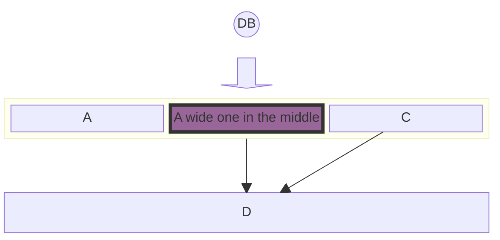

</details>

## C4

```text
     Component diagram for Internet Banking System - API Application

    ┌───────────────────────────┐        ┌────────────────────────────┐
    │        «container»        │        │        «container»         │
    ├───────────────────────────┤        ├────────────────────────────┤
    │  Single Page Application  │        │         Mobile App         │
    ├───────────────────────────┤        ├────────────────────────────┤
    │ [javascript and angular]  │        │         [Xamarin]          │
    ├───────────────────────────┤        ├────────────────────────────┤
    │ Provides all the internet │        │ Provides a limited subset  │
    │ banking functionality to  │        │  to the internet banking   │
    │  customers via their web  │        │ functionality to customers │
    │         browser.          │        │  via their mobile device.  │
    └─────────────┬────────┬────┘        └────┬───────────┬───────────┘
                  ▲        │                  │           │
                  │      Uses                 │         Uses
                  │  [JSON/HTTPS]             │     [JSON/HTTPS]
                Uses       │                Uses          │
            [JSON/HTTPS]   │            [JSON/HTTPS]      │
                  │        │                  │           │
                  │        │┌─────────────────┘           │
                  │        └┼─────────────────────┐       │
                  │         │                     │       │
                  │         │                     │       │
┌─────────────────┼─────────┼─ API Application ───┼───────┼─────────────┐
│                 │         │    [CONTAINER]      │       │             │
│                 │         │                     │       │             │
│                 │         │                     │       │             │
│                 │         │                     ▼       ▼             │
│                 │         ▼           ┌───────────────────────────┐   │
│   ┌─────────────┴──────────────┐      │        «component»        │   │
│   │        «component»         │      ├───────────────────────────┤   │
│   ├────────────────────────────┤      │     Accounts Summary      │   │
│   │     Sign In Controller     │      │        Controller         │   │
│   ├────────────────────────────┤      ├───────────────────────────┤   │
│   │   [MVC Rest Controller]    │      │   [MVC Rest Controller]   │   │
│   ├────────────────────────────┤      ├───────────────────────────┤   │
│   │ Allows users to sign in to │      │ Provides customers with a │   │
│   │    the internet banking    │      │   summary of their bank   │   │
│   │           system           │      │         accounts          │   │
│   └──────────────┬─────────────┘      └─────────────┬─────────────┘   │
│                  │                                  │                 │
│                  │                                  │                 │
│                  │                                  │                 │
│                Uses                               Uses                │
│                  │                                  │                 │
│                  │                                  │                 │
│                  ▼                                  ▼                 │
│    ┌──────────────────────────┐       ┌───────────────────────────┐   │
│    │       «component»        │       │        «component»        │   │
│    ├──────────────────────────┤       ├───────────────────────────┤   │
│    │    Security Component    │       │ Mainframe Banking System  │   │
│    ├──────────────────────────┤       │          Facade           │   │
│    │      [Spring Bean]       │       ├───────────────────────────┤   │
│    ├──────────────────────────┤       │       [Spring Bean]       │   │
│    │  Provides functionality  │       ├───────────────────────────┤   │
│    │  related to singing in,  │       │     A facade onto the     │   │
│    │ changing passwords, etc. │       │ mainframe banking system. │   │
│    └─────────────┬────────────┘       └─────────────┬─────────────┘   │
│                  │                                  │                 │
│                  │                                  │                 │
│                  │                                  │                 │
└──────────────────┼──────────────────────────────────┼─────────────────┘
                   │                                  │
                   │                                  │
            Read & write to                         Uses
                [JDBC]                           [XML/HTTPS]
                   │                                  │
                   │                                  │
                   ▼                                  ▼
     ╭───────────────────────────╮      ┌───────────────────────────┐
     ├───────────────────────────┤      │     «external system»     │
     │      «container db»       │      ├───────────────────────────┤
     ├───────────────────────────┤      │ Mainframe Banking System  │
     │         Database          │      ├───────────────────────────┤
     ├───────────────────────────┤      │  Stores all of the core   │
     │   [Relational Database    │      │ banking information about │
     │          Schema]          │      │   customers, accounts,    │
     ├───────────────────────────┤      │    transactions, etc.     │
     │ Stores user registration  │      └───────────────────────────┘
     │    information, hashed    │
     │      authentication       │
     │ credentials, access logs, │
     │           etc.            │
     ╰───────────────────────────╯
```

<details><summary>Source</summary>

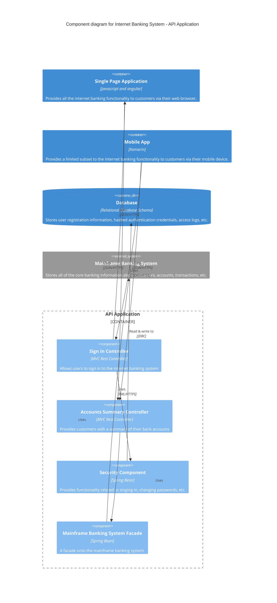

</details>

## Class

```text
                          ┌─ Company ──────────────┐
                          │                        │
                          │                        │
                          │  ┌──────────────────┐  │
                          │  │       CEO        │  │
                          │  ├──────────────────┤  │
                          │  │                  │  │
                          │  ├──────────────────┤  │
                          │  │ +makeDecisions() │  │
                          │  └───────┬──┬───────┘  │
                          │          │  │          │
                          └──────────┼──┼──────────┘
                                     │  │
                  ┌──────────────────┘  └──────────────────┐
                  │                                        │
                  │                                        │
         oversees │                               oversees │
                  │                                        │
                  │                                        │
                  │                                        │
┌─ Company. ──────┼────────────────┐     ┌─ Company. ──────┼─────────────────┐
│  Engineering.   │                │     │  Engineering.   │                 │
│  Backend        │                │     │  Frontend       │                 │
│                 │                │     │                 │                 │
│                 │                │     │                 │                 │
│                 ▼                │     │                 ▼                 │
│         ┌──────────────┐         │     │        ┌─────────────────┐        │
│         │  Developer   │         │     │        │    Designer     │        │
│         ├──────────────┤         │     │        ├─────────────────┤        │
│         │              │         │     │        │                 │        │
│         ├──────────────┤         │     │        ├─────────────────┤        │
│         │ +writeCode() │         │     │        │ +createMockup() │        │
│         └──────────────┘         │     │        └─────────────────┘        │
│                                  │     │                                   │
└──────────────────────────────────┘     └───────────────────────────────────┘
```

<details><summary>Source</summary>

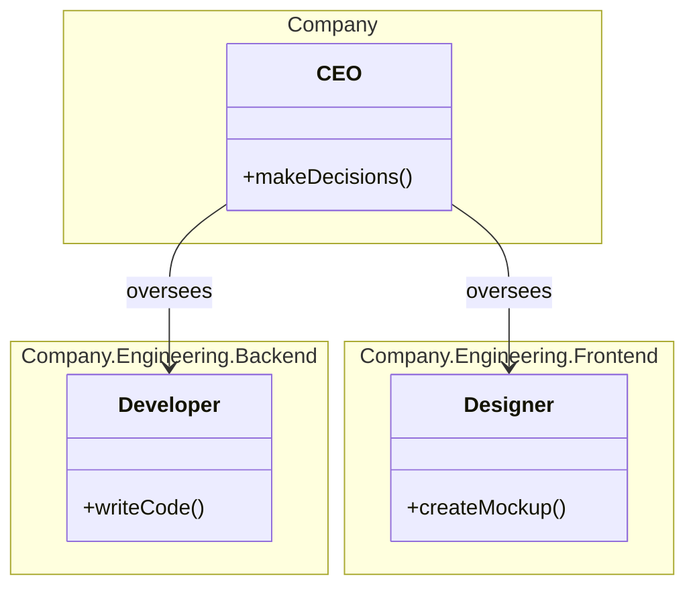

</details>

## Cynefin

```text
                               Strategy Categorization

┌─ Complex ────────────────────┐                      ┌─ Complicated ────────────────┐
│                              │  Pattern identified  │                              │
│   Probe → Sense → Respond    ├─────────────────────▶┤  Sense → Analyse → Respond   │
│      Emergent Practices      │                      │        Good Practices        │
│                              │                      │                              │
│       Market research        │                      │     Competitive analysis     │
│                              │                      │                              │
└───────────────┬──────────────┘                      └───────────────┬──────────────┘
                ▲                                                     │
    Stabilized  │                                                     │ Best practice
                │                                                     │ codified
                │                                                     │
                │          ┌─ Confusion ──────────────────┐           │
                │          │                              │           │
                │          │           Disorder           │           │
                │          │                              │           │
                │          └──────────────────────────────┘           │
                │                                                     ▼
┌─ Chaotic ─────┴──────────────┐                      ┌─ Clear ───────┴──────────────┐
│                              │     Complacency      │                              │
│    Act → Sense → Respond     ├◀─────────────────────┤ Sense → Categorise → Respond │
│       Novel Practices        │                      │        Best Practices        │
│                              │                      │                              │
│      Crisis management       │                      │       Standard pricing       │
│                              │                      │                              │
└──────────────────────────────┘                      └──────────────────────────────┘
```

<details><summary>Source</summary>

```mermaid
cynefin-beta
  title Strategy Categorization

  complex
    "Market research"

  complicated
    "Competitive analysis"

  clear
    "Standard pricing"

  chaotic
    "Crisis management"

  complex --> complicated : "Pattern identified"
  complicated --> clear : "Best practice codified"
  clear --> chaotic : "Complacency"
  chaotic --> complex : "Stabilized"
```

</details>

## Entity relationship

```text
                                     ┌─ title2 ─────────────────────────────────────────────┐
                                     │                                                      │
                                     │                        ┌─ title3 ─────────────────┐  │
                                     │                        │                          │  │
                                     │                        │                          │  │
                                     │                        │  ┌────────────────────┐  │  │
                                     │                        │  │       PERSON       │  │  │
                                     │                        │  ├────────┬───────────┤  │  │
┌─ title1 ──────────────────┐        │                        │  │ string │ firstName │  │  │
│                           │        │                        │  │ string │ lastName  │  │  │
│  ┌─────────────────────┐  │        │       ┌─────┐          │  │ int    │ age       │  │  │
│  │      CUSTOMER       │  │        │       │ CAR │          │  └────────┴───────────┘  │  │
│  ├────────┬────────────┤  │        │       └──┬──┘          │                          │  │
│  │ string │ name       │  │        │         ─┼─            └──────────────────────────┘  │
│  │ string │ custNumber │  │        │         ─┼─                                          │
│  │ string │ sector     │  │        │          │                                           │
│  └────────┴────────────┘  │        │          │                                           │
│                           │        │       allows                                         │
└───────────────────────────┘        │          │                                           │
                                     │          │                                           │
                                     │          ○                                           │
                                     │         ╱│╲                                          │
                                     │  ┌───────┴──────┐                                    │
                                     │  │ NAMED-DRIVER │                                    │
                                     │  └──────────────┘                                    │
                                     │                                                      │
                                     └──────────────────────────────────────────────────────┘
```

<details><summary>Source</summary>

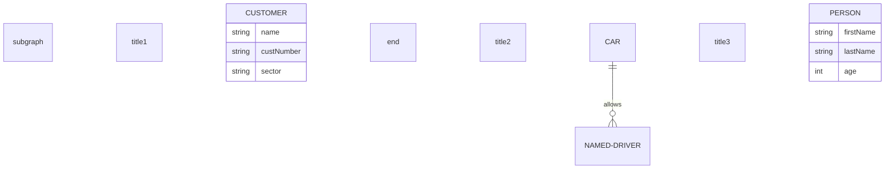

</details>

## Event modeling

```text
    UI/Automation        Command/Read Model      Stream: External         Stream: Cart

                                               ┌─ 03 ─────────────┐
                                               │ InventoryChanged │
                                               └┬─────────────────┘
                                                │
                    ┌───────────────────────────┘
                    ▼
┌─ 02 ───────────────┐
│ InventoryProcessor │
└───────────────────┬┘
                    │
                    └─────────────────────┐
                                          ▼
                         ┌─ 04 ────────────┐
                         │ ChangeInventory │
                         └────────────────┬┘
                                          │
                                          └─────────────────────────────────────────────┐
                                                                                        ▼
                                                                      ┌─ 05 ─────────────┐
                                                                      │ InventoryChanged │
                                                                      └──────────────────┘
```

<details><summary>Source</summary>

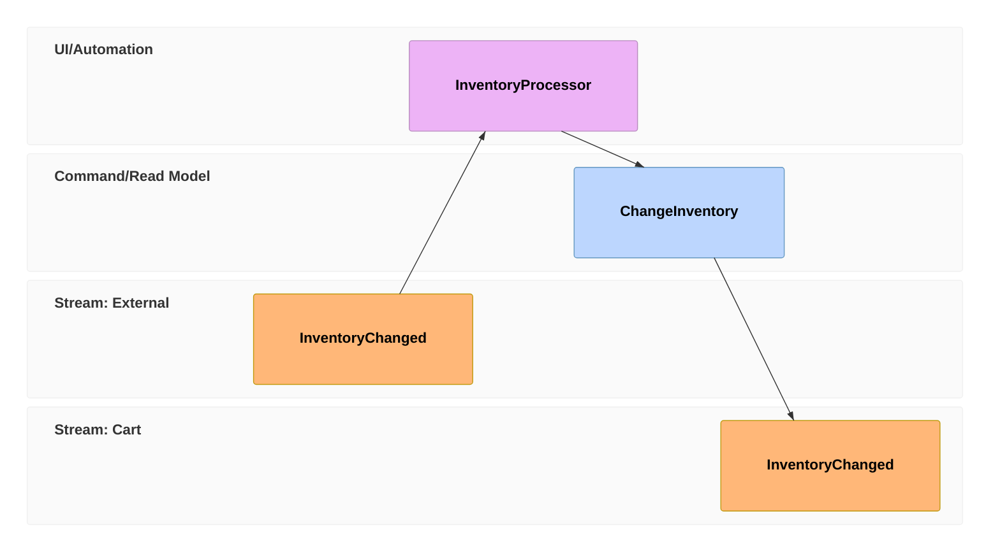

</details>

## Flowchart

```text
        ╭─ TOP ──────────────────────╮
        │                            │
        │  ╭─ B1 ─────────────────╮  │
        │  │                      │  │
        │  │                      │  │
        │  │  ┌────┐      ┌────┐  │  │
        │  │  │ f1 │◀─────┤ i1 │  │  │
        │  │  └────┘      └────┘  │  │
        │  │                      │  │
        │  ╰───────────┬──────────╯  │
        │              │             │
        │              │             │
        │              ▼             │
┌───┐   │        ╭─ B2 ─────╮        │     ┌───┐
│ A ├──▶│        │          │        ├────▶│ B │
└───┘   │        │  ┌────┐  │        │     └───┘
        │        │  │ f2 │  │        │
        │        │  └────┘  │        │
        │        │     ▲    │        │
        │        │     │    │        │
        │        │     │    │        │
        │        │     │    │        │
        │        │     │    │        │
        │        │  ┌──┴─┐  │        │
        │        │  │ i2 │  │        │
        │        │  └────┘  │        │
        │        │          │        │
        │        ╰──────────╯        │
        │                            │
        ╰────────────────────────────╯
```

<details><summary>Source</summary>

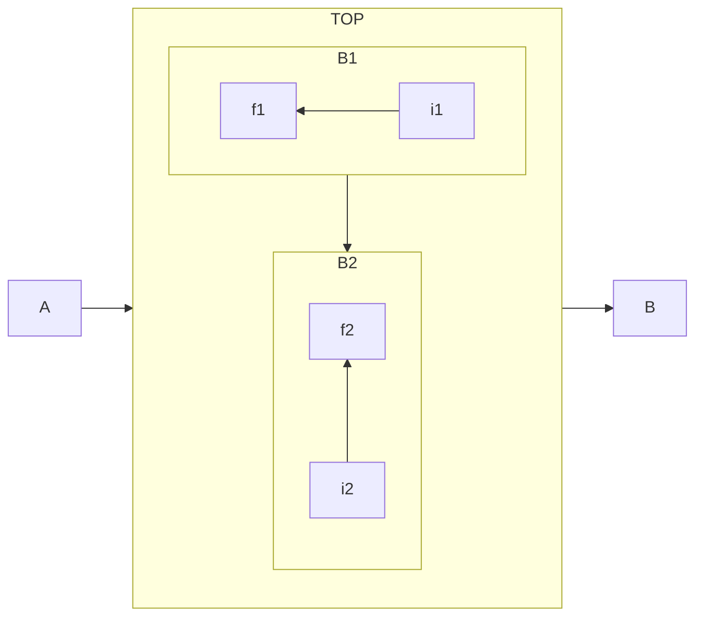

</details>

## Gantt

```text
                                      Timeline - Gantt Sampler

                 9
                 ▼
                 ┆
00   02   04    06    08   10    12    14   16    18    20   22    24    26   28    30    32   34
└─────┴────┴─────┼─────┴────┴─────┴─────┴────┴─────┴─────┴────┴─────┴─────┴────┴─────┴─────┴────┴───
                 ┆
── Issue19062 ───┼──────────────────────────────────────────────────────────────────────────────────
                 ┆
71               ┆
█████████████████████████████████████████████████████████████████████████████████████
                 ┆
── Issue19401 ───┼──────────────────────────────────────────────────────────────────────────────────
                 ┆
                 ┆                   36
                 ┆                   ██████████████████████████████████████████████████████████████
                 ┆
── Issue1300 ────┼──────────────────────────────────────────────────────────────────────────────────
                 ┆
                 ┆          94                     0     5
                 ┆          ██████████████         ◆     ██████████████
                 ┆
                 ┆                                               64
                 ┆                                               █
                 ┆
┌─────┬────┬─────┼─────┬────┬─────┬─────┬────┬─────┬─────┬────┬─────┬─────┬────┬─────┬─────┬────┬───
00   02   04    06    08   10    12    14   16    18    20   22    24    26   28    30    32   34
```

<details><summary>Source</summary>

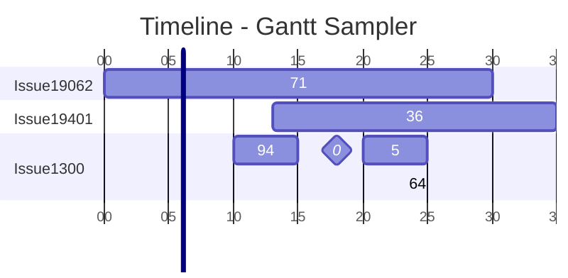

</details>

## Git graph

```text
main  hotfix  develop  featureB  featureA  release

  ●──────┐
  │      │
  │      ●───────┐
  │      │       │
  │      │       ●─────────┐                         ash
  │      │       │         │                         abc
  │      │       │         │
  │      │       │         ■
  │      │       │         │
  │      ●       │         │
  │      │       │         │
  │      │       ×─────────┼─────────┐
  │      │       │         │         │
  │      │       │         ●         │
  │      │       │         │         │
  ◉──────┤       │         │         │
  │      │       │         │         │
  │      │       │         ●         │
  │      │       │         │         │
  │      │       │         │         ●
  │      │       │         │         │
  │      └───────◉         │         │
  │              │         │         │
  │              │         │         ●
  │              │         │         │
  │              │         ●         │
  │              │                   │
  │              ◉───────────────────┴────────┐
  │              │                            │
  │              │                            ●
  │              │                            │
  ●              │                            │
  │              │                            │
  └──────────────┼────────────────────────────◉
                 │                            │
                 ◉────────────────────────────┘
```

<details><summary>Source</summary>

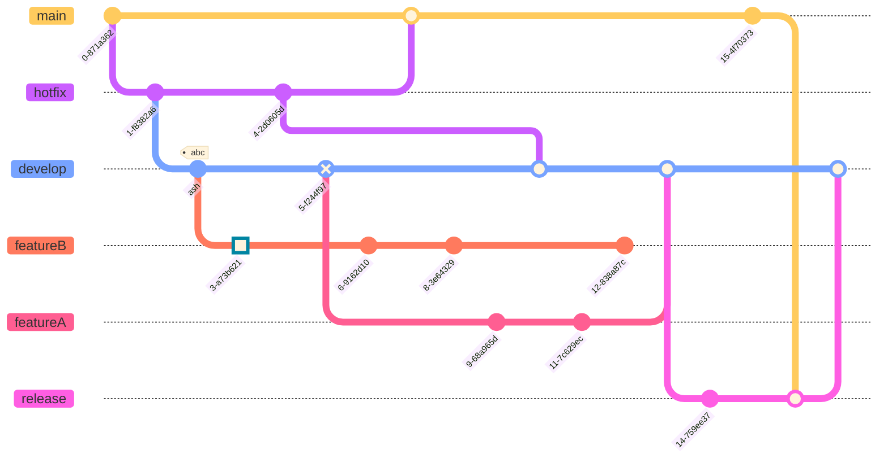

</details>

## Ishikawa

```text
                                               ┌──── Inappropriate lens
                                               │
                                               ├──── Damaged lens
                                               │
                                               ├──── Dirty lens
  ┌──── Out of focus                           ▼
  │                                      ┌──── LENS
  ├──── Shutter speed too slow           │
  │                                      │     ┌──── Damaged sensor
  ├──── Protective film not removed      │     │
  │                                      │     ├──── Dirty sensor
  ├──── Beautification                   │     ▼
  │     filter applied                   ├──── SENSOR
  ▼                                      ▼
┌─┴───────┐                            ┌─┴─────────┐
│ Process │                            │ Equipment │
└─┬───────┘                            └─┬─────────┘
  └──┐                                   └──┐
     ▼                                      ▼                                 ┌──────────────┐
─────┼──────────────────────────────────────┼────────────────────────────────▶┤ Blurry Photo │
     ▲                                      ▲                                 └──────────────┘
  ┌──┘                                   ┌──┘
┌─┴────┐                               ┌─┴───────────┐
│ User │                               │ Environment │
└─┬────┘                               └─┬───────────┘
  ▲                                      ▲
  └──── Shaky hands                      ├──── Subject moved too quickly
                                         │
                                         └──── Too dark
```

<details><summary>Source</summary>

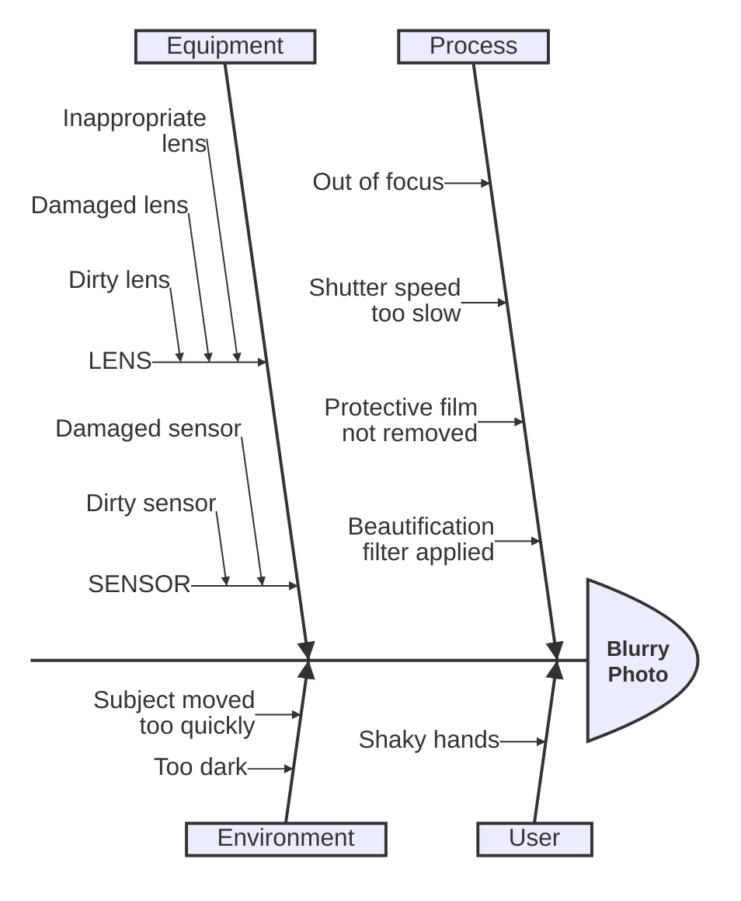

</details>

## User journey

```text
                         My working day

┌─ Go to work ──────────────────┐  ┌─ Go home ──────────────────┐
│                               │  │                            │
│  Make tea     ●●●●●  Me       │  │  Go downstairs  ●●●●●  Me  │
│  Go upstairs  ●●●○○  Me       │  │  Sit down       ●●●●●  Me  │
│  Do work      ●○○○○  Me, Cat  │  │                            │
│                               │  └────────────────────────────┘
└───────────────────────────────┘
```

<details><summary>Source</summary>

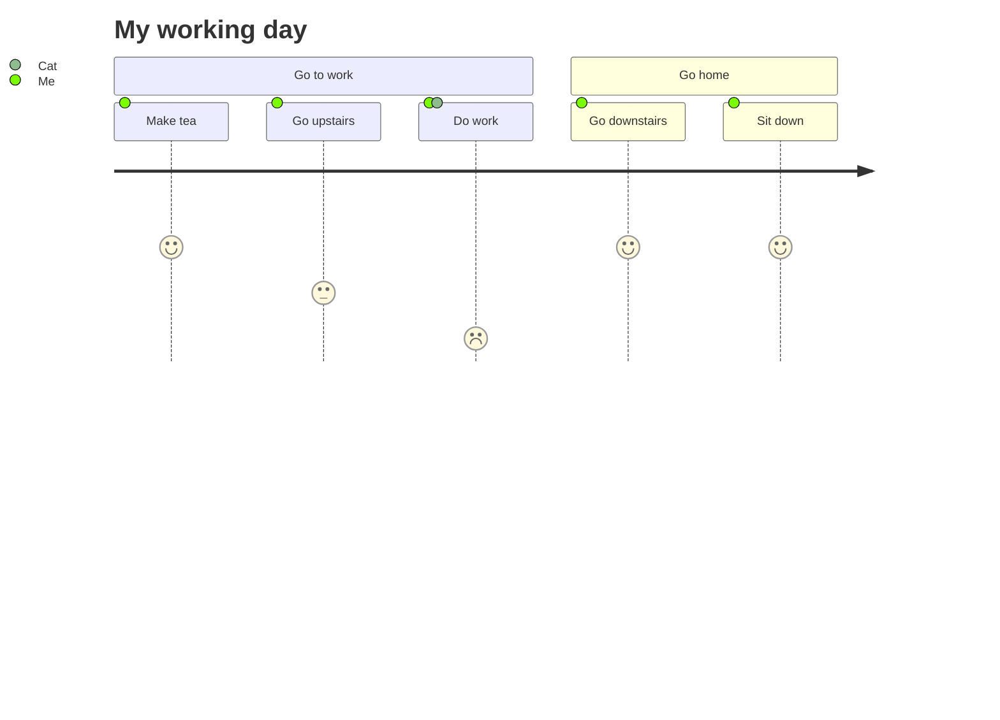

</details>

## Kanban

```text
┌─ Todo ───────────────────────┐
│                              │
│ ┌──────────────────────────┐ │
│ │ Update Database Function │ │
│ ├──────────────────────────┤ │
│ │         MC-2037          │ │
│ ├──────────────────────────┤ │
│ │          @knsv           │ │
│ ├──────────────────────────┤ │
│ │           High           │ │
│ └──────────────────────────┘ │
│                              │
└──────────────────────────────┘
```

<details><summary>Source</summary>

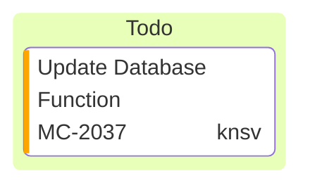

</details>

## Mindmap

```text
┌───────────────────────┐
│       Root with       │
│     a second line     │
│ Unicode works too: 🤓 │
└─┬─────────────────────┘
  │
  │   ┌───────────────────────┐
  │   │ The dog in the hog... │
  ├───┤ a very long text that │
  │   │  wraps to a new line  │
  │   └───────────────────────┘
  │
  │   ┌────────────────────────────┐
  └───┤ Regular labels still works │
      └────────────────────────────┘
```

<details><summary>Source</summary>

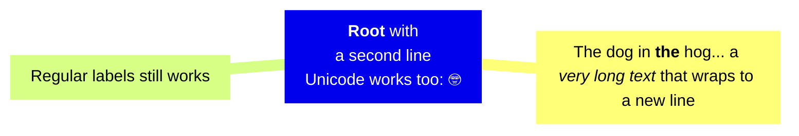

</details>

## Packet

```text
                                           UDP Packet

 0                                                                                            15
┌───────────────────────────────────────────────────────────────────────────────────────────────┐
│                                          Source Port                                          │
└───────────────────────────────────────────────────────────────────────────────────────────────┘

 16                                                                                           31
┌───────────────────────────────────────────────────────────────────────────────────────────────┐
│                                       Destination Port                                        │
└───────────────────────────────────────────────────────────────────────────────────────────────┘

 32                                                                                           47
┌───────────────────────────────────────────────────────────────────────────────────────────────┐
│                                            Length                                             │
└───────────────────────────────────────────────────────────────────────────────────────────────┘

 48                                                                                           63
┌───────────────────────────────────────────────────────────────────────────────────────────────┐
│                                           Checksum                                            │
└───────────────────────────────────────────────────────────────────────────────────────────────┘

 64                                                                                           79
┌───────────────────────────────────────────────────────────────────────────────────────────────┐
│                                    Data (variable length)                                     │
└───────────────────────────────────────────────────────────────────────────────────────────────┘

 80                                                                                           95
┌───────────────────────────────────────────────────────────────────────────────────────────────┐
│                                    Data (variable length)                                     │
└───────────────────────────────────────────────────────────────────────────────────────────────┘
```

<details><summary>Source</summary>

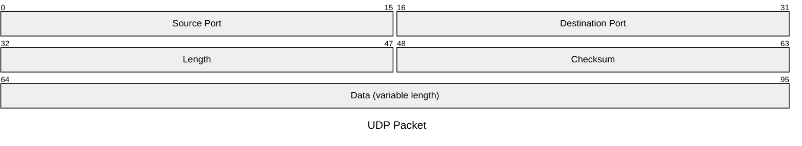

</details>

## Pie

```text
                    Key elements in Product X

Calcium    ███████████████▉                          42.96  39.8%
Potassium  ██████████████████▌                       50.05  46.3%
Magnesium  ███▊                                      10.01   9.3%
Iron       █▉                                            5   4.6%
```

<details><summary>Source</summary>

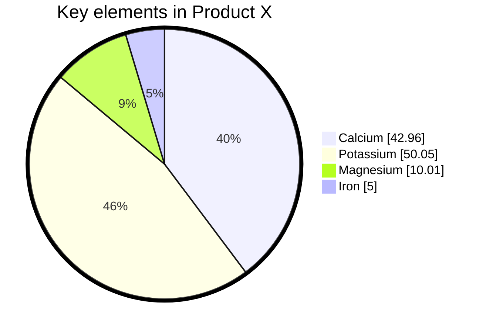

</details>

## Quadrant chart

```text
                            Reach and engagement of campaigns

High Engagement  ┌───────────────────────────────────┬───────────────────────────────────┐
                 │          Need to promote          │         We should expand          │
                 │                                   │                                   │
                 │                                   │                                   │
                 │                                   │                                   │
                 │                                   │                                   │
                 │              Campaign F ●         │                                   │
                 │                                   │    ● Campaign C                   │
                 │                     ● Campaign A  │                                   │
                 │                                   │                                   │
                 ├───────────────────────────────────┼───────────────────────────────────┤
                 │            Re-evaluate            │          May be improved          │
                 │                                   │                                   │
                 │                 Campaign E ●      │                  ● Campaign D     │
                 │                     Campaign B ●  │                                   │
                 │                                   │                                   │
                 │                                   │                                   │
                 │                                   │                                   │
                 │                                   │                                   │
                 │                                   │                                   │
Low Engagement   └───────────────────────────────────┴───────────────────────────────────┘
                 Low Reach                                                      High Reach
```

<details><summary>Source</summary>

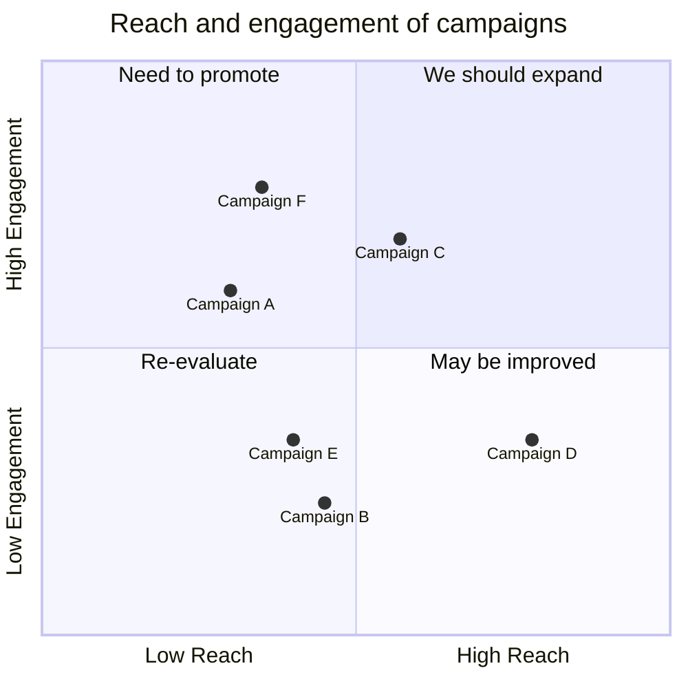

</details>

## Radar

```text
          Restaurant Comparison

Food Quality
  Restaurant A  ███████████████████▎     4
  Restaurant B  ██████████████▍          3
  Restaurant C  █████████▋               2
  Restaurant D  █████████▋               2

Service
  Restaurant A  ██████████████▍          3
  Restaurant B  ███████████████████▎     4
  Restaurant C  ██████████████▍          3
  Restaurant D  █████████▋               2

Price
  Restaurant A  █████████▋               2
  Restaurant B  ██████████████▍          3
  Restaurant C  ███████████████████▎     4
  Restaurant D  ███████████████████▎     4

Ambiance
  Restaurant A  ███████████████████▎     4
  Restaurant B  ██████████████▍          3
  Restaurant C  █████████▋               2
  Restaurant D  ██████████████▍          3
```

<details><summary>Source</summary>

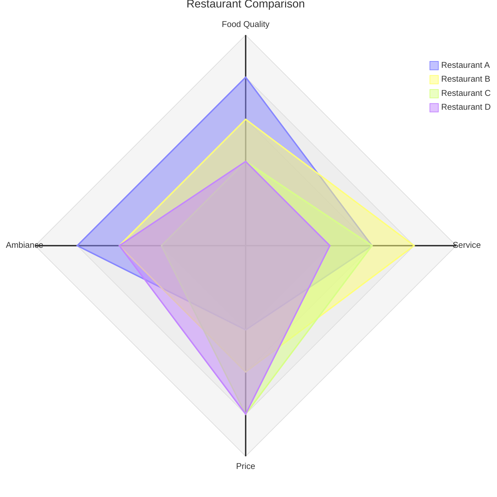

</details>

## Railroad

```text
                    Phone Number

phone

    ┌────────────▶─────────────┐
    │                          │
    │ ╭───╮   ┌──────────────┐ │    ┌────────────┐
●───┴─┤ + ├───┤ country-code ├─┴────┤ subscriber ├──▶
      ╰───╯   └──────────────┘      └────────────┘

country-code

      ┌───────┐
●───┬─┤ DIGIT ├─┬───▶
    │ └───────┘ │
    │           │
    └─────◀─────┘
       1..* x

subscriber

         ┌───────┐
●───┬──┬─┤ DIGIT ├─┬──┬───▶
    │  │ └───────┘ │  │
    │  │           │  │
    │  │   ╭───╮   │  │
    │  ├───┤ - ├───┤  │
    │  │   ╰───╯   │  │
    │  │           │  │
    │  │   ╭───╮   │  │
    │  └───┤ ␣ ├───┘  │
    │      ╰───╯      │
    │                 │
    └────────◀────────┘
          1..* x
```

<details><summary>Source</summary>

```mermaid
railroad-abnf-beta
title "Phone Number"

phone = [ "+" country-code ] subscriber ;
country-code = 1*DIGIT ;
subscriber = 1*( DIGIT / "-" / " " ) ;
```

</details>

## Requirement

```text
┌──────────────────────┐
│    «Requirement»     │
├──────────────────────┤
│     checkout_req     │
├──────────────────────┤     ┌──────────────────┐
│        ID: 1         │     │    «Element»     │
│ Text: Orders must be │     ├──────────────────┤
│   payable online.    │     │ checkout_service │
│      Risk: High      │     ├──────────────────┤
│  Verification: Test  │     │  Type: service   │
└─────────────────┬────┘     └────┬─────────────┘
                  ⊕               ┆
                  │               ┆
              contains        satisfies
                  │               ┆
                  │               ┆
                  │               ┆
                  │               ▽
            ┌─────┴────────────────────┐
            │ «Functional Requirement» │
            ├──────────────────────────┤
            │       payment_req        │
            ├──────────────────────────┤
            │         ID: 1.1          │
            │ Text: Card payments must │
            │      be authorised.      │
            │        Risk: High        │
            │    Verification: Test    │
            └──────────────────────────┘
```

<details><summary>Source</summary>

```mermaid
requirementDiagram
  requirement checkout_req {
    id: 1
    text: Orders must be payable online.
    risk: high
    verifymethod: test
  }
  functionalRequirement payment_req {
    id: 1.1
    text: Card payments must be authorised.
    risk: high
    verifymethod: test
  }
  element checkout_service {
    type: service
  }
  checkout_req - contains -> payment_req
  checkout_service - satisfies -> payment_req
```

</details>

## Sankey

```text
Pumped heat                                                 263.7
├─▶ Heating and cooling, "homes"       ████████████████████ 193.0
└─▶ Heating and cooling, "commercial"  ███████▍              70.7
```

<details><summary>Source</summary>

```mermaid
sankey

Pumped heat,"Heating and cooling, ""homes""",193.026
Pumped heat,"Heating and cooling, ""commercial""",70.672
```

</details>

## Sequence

```text
      ○
     ─┼─
     ╱ ╲
┌──────────┐                       ┌─────────┐         ┌─────────────┐              ┌──────┐
│ Customer │                       │ Web app │         │ API gateway │              │ Bank │
└─────┬────┘                       └────┬────┘         └──────┬──────┘              └───┬──┘
      │                                 │                     │                         │
      │         1. Place order          │                     │                         │
      ├────────────────────────────────▶│                     │                         │
      │                                 │                     │                         │
      │                                 │  2. POST /orders    │                         │
      │                                 ├────────────────────▶┃                         │
      │                                 │                     ┃                         │
      │                                 │                     ┃  3. Authorise payment   │
      │                                 │                     ┠────────────────────────▶│
      │                                 │                     ┃                         │
      │                                 │                     ┃      4. Approved        │
      │                                 │                     ┃◀┄┄┄┄┄┄┄┄┄┄┄┄┄┄┄┄┄┄┄┄┄┄┄┄┤
      │                                 │                     ┃                         │
      │                                 │   5. 201 Created    ┃                         │
      │                                 │◀┄┄┄┄┄┄┄┄┄┄┄┄┄┄┄┄┄┄┄┄┨                         │
      │                                 │                     ┃                         │
      │       6. Order confirmed        │                     │                         │
      │◀┄┄┄┄┄┄┄┄┄┄┄┄┄┄┄┄┄┄┄┄┄┄┄┄┄┄┄┄┄┄┄┄┤                     │                         │
      │                                 │                     │                         │
    ┌─────────────────────────────────────────────────────────────────────────────────────┐
    │                             One order, one transaction                              │
    └─────────────────────────────────────────────────────────────────────────────────────┘
      │                                 │                     │                         │
┌─────┴────┐                       ┌────┴────┐         ┌──────┴──────┐              ┌───┴──┐
│ Customer │                       │ Web app │         │ API gateway │              │ Bank │
└──────────┘                       └─────────┘         └─────────────┘              └──────┘
```

<details><summary>Source</summary>

```mermaid
sequenceDiagram
  autonumber
  actor Customer
  participant Web as Web app
  participant API as API gateway
  participant Bank
  Customer->>Web: Place order
  Web->>API: POST /orders
  activate API
  API->>Bank: Authorise payment
  Bank-->>API: Approved
  API-->>Web: 201 Created
  deactivate API
  Web-->>Customer: Order confirmed
  Note over Customer,Bank: One order, one transaction
```

</details>

## State

```text
             ●
             │
             │
             │
             ▼
         ━┯━━━━━┯━
          │     │
          │     │
        ┌─┘     │
        ▼       ▼
╭────────╮     ╭────────╮
│ State2 │     │ State3 │
╰───────┬╯     ╰┬───────╯
        │       │
        │       │
        └─┐     │
          ▼     ▼
         ━━━━┯━━━━
             │
             │
             │
             ▼
        ╭────────╮
        │ State4 │
        ╰────┬───╯
             │
             │
             │
             ▼
             ◉
```

<details><summary>Source</summary>

```mermaid
stateDiagram-v2
    state fork_state <<fork>>
      [*] --> fork_state
      fork_state --> State2
      fork_state --> State3

      state join_state <<join>>
      State2 --> join_state
      State3 --> join_state
      join_state --> State4
      State4 --> [*]
```

</details>

## Swimlane

```text
┌─ Intake ───────────────┐  ┌─ Review ─────────────┐  ┌─ Delivery ──────────┐
│                        │  │                      │  │                     │
│   ┌─────────────────┐  │  │    No                │  │                     │
│   │ Collect request │◀─┼──┼─────────────────────┐│  │                     │
│   └────────┬────────┘  │  │                     ││  │                     │
│            │           │  │                     ││  │                     │
│            │           │  │                     ││  │                     │
│            │           │  │                     ││  │                     │
│            ▼           │  │                     ││  │                     │
│  ┌──────────────────┐  │  │                     ││  │                     │
│  │ Validate details │  │  │                     ││  │                     │
│  └─────────────────┬┘  │  │                     ││  │                     │
│                    │   │  │                     ││  │                     │
│                    │   │  │  ┌────────────────┐ ││  │                     │
│                    └───┼──┼─▶│ Review request │ ││  │                     │
│                        │  │  └───────┬────────┘ ││  │                     │
│                        │  │          │          ││  │                     │
│                        │  │          │          ││  │                     │
│                        │  │          │          ││  │                     │
│                        │  │          ▼          ││  │                     │
│                        │  │      ╱────────╲     ││  │                     │
│                        │  │      │ Ready? ├─────┘│  │                     │
│                        │  │      ╲───────┬╱      │  │                     │
│                        │  │              │       │  │                     │
│                        │  │              │       │  │                     │
│                        │  │              │       │  │                     │
│                        │  │              │       │  │                     │
│                        │  │              │   Yes │  │  ┌───────────────┐  │
│                        │  │              └───────┼──┼─▶│ Schedule work │  │
│                        │  │                      │  │  └───────┬───────┘  │
│                        │  │                      │  │          │          │
│                        │  │                      │  │          │          │
│                        │  │                      │  │          │          │
│                        │  │                      │  │          ▼          │
│                        │  │                      │  │  ┌───────────────┐  │
│                        │  │                      │  │  │ Complete work │  │
│                        │  │                      │  │  └───────────────┘  │
│                        │  │                      │  │                     │
└────────────────────────┘  └──────────────────────┘  └─────────────────────┘
```

<details><summary>Source</summary>

```mermaid
swimlane-beta TB
  subgraph Intake
    collect[Collect request]
    validate[Validate details]
  end

  subgraph Review
    review[Review request]
    decide{Ready?}
  end

  subgraph Delivery
    schedule[Schedule work]
    complete[Complete work]
  end

  collect --> validate --> review --> decide
  decide -->|Yes| schedule --> complete
  decide -->|No| collect
```

</details>

## Timeline

```text
                             England's History Timeline

┌─ Stone Age ───────────────────────────────────────────────────────────────────────┐
│                                                                                   │
│  7600 BC ─●─ Britain's oldest known house was built in Orkney, Scotland           │
│           │                                                                       │
│  6000 BC ─●─ Sea levels rise and Britain becomes an island.                       │
│           │  The people who live here are hunter-gatherers.                       │
│                                                                                   │
└───────────────────────────────────────────────────────────────────────────────────┘

┌─ Bronze Age ──────────────────────────────────────────────────────────────────────┐
│                                                                                   │
│  2300 BC ─●─ People arrive from Europe and settle in Britain.                     │
│           │  They bring farming and metalworking.                                 │
│           │  New styles of pottery and ways of burying the dead appear.           │
│           │                                                                       │
│  2200 BC ─●─ The last major building works are completed at Stonehenge.           │
│           │  People now bury their dead in stone circles.                         │
│           │  The first metal objects are made in Britain.Some other nice things   │
│           │  happen. it is a good time to be alive.                               │
│                                                                                   │
└───────────────────────────────────────────────────────────────────────────────────┘
```

<details><summary>Source</summary>

```mermaid
timeline
        title England's History Timeline
        section Stone Age
          7600 BC : Britain's oldest known house was built in Orkney, Scotland
          6000 BC : Sea levels rise and Britain becomes an island.<br> The people who live here are hunter-gatherers.
        section Bronze Age
          2300 BC : People arrive from Europe and settle in Britain. <br>They bring farming and metalworking.
                  : New styles of pottery and ways of burying the dead appear.
          2200 BC : The last major building works are completed at Stonehenge.<br> People now bury their dead in stone circles.
                  : The first metal objects are made in Britain.Some other nice things happen. it is a good time to be alive.
```

</details>

## Treemap

```text
Budget             ████████████████████████████████████████  $1,500,000  100.0%
├─ Operations      ██████████████████████████▋               $1,000,000   66.7%
│  ├─ Salaries     ██████████████████▋                         $700,000   46.7%
│  ├─ Equipment    █████▍                                      $200,000   13.3%
│  └─ Supplies     ██▋                                         $100,000    6.7%
└─ Marketing       █████████████▍                              $500,000   33.3%
   ├─ Advertising  ██████████▋                                 $400,000   26.7%
   └─ Events       ██▋                                         $100,000    6.7%
```

<details><summary>Source</summary>

```mermaid
---
config:
  treemap:
    valueFormat: '$0,0'
---
treemap-beta
"Budget"
    "Operations"
        "Salaries": 700000
        "Equipment": 200000
        "Supplies": 100000
    "Marketing"
        "Advertising": 400000
        "Events": 100000
```

</details>

## Tree view

```text
├──── packages/
│     │
│     ├── mermaid/
│     │   │
│     │   ├── src/
│     │   │   │
│     │   │   ├── parser.ts
│     │   │   │
│     │   │   └── renderer.ts
│     │   │
│     │   └── package.json
│     │
│     └── parser/
│         │
│         └── src/
│
└──── README.md
```

<details><summary>Source</summary>

```mermaid
treeView-beta
├── packages/
│   ├── mermaid/
│   │   ├── src/
│   │   │   ├── parser.ts
│   │   │   └── renderer.ts
│   │   └── package.json
│   └── parser/
│       └── src/
└── README.md
```

</details>

## Use case

```text
                 ┌─ Storefront ────────────────────────────────────────┐
                 │                                                     │
                 │                                                     │
              ┌──┼─────────────────────────────┐                       │
    ○         │  │                             │ ╭──────────────────╮  │
   ─┼─────────┘  │                             └▶│                  │  │
    │            │  ╭──────────╮                 │ Browse catalogue │  │
    ├────────────┼─▶│ Checkout ├┄┄┄ include ┄┄┄┄▶│                  │  │
    │            │  │          │                 │                  │  │
   ╱ ╲           │  ╰──────────╯                 ╰──────────────────╯  │
Customer──────┐  │                                                     │
              │  │                                                     │
              │  └─────────────────────────────────────────────────────┘
              │  ┌─ Fulfilment ─────────┐
              │  │                      │
              │  │                      │
              │  │                      │
              │  │  ╭────────────────╮  │
     ○        └──┼─▶│                │  │
    ─┼─          │  │ Track delivery │  │
     └────────┐  │  │                │  │
    ╱ ╲       └──┼─▶│                │  │
  Support        │  ╰────────────────╯  │
                 │                      │
                 │                      │
                 └──────────────────────┘
```

<details><summary>Source</summary>

```mermaid
usecase-beta
direction LR
actor Customer
actor Support
systemBoundary Storefront
  Browse("Browse catalogue")
  Checkout("Checkout")
end
systemBoundary Fulfilment
  Track("Track delivery")
end
Customer --> Browse
Customer --> Checkout
Customer --> Track
Support --> Track
Checkout ..> : include Browse
```

</details>

## Venn

```text
            What makes a good feature

┌─ Desirable ─────────────────┐
│                             │
│                ┌────────────┼─ Feasible ──────┐
│                │            │                 │
│                │ Buildable  │                 │
│                │            │                 │
│  ┌─ Viable ────┼────────────┼──────────────┐  │
│  │             │            │              │  │
│  │ Marketable  │  Ship it   │ Sustainable  │  │
│  │             │            │              │  │
└──┼─────────────┼────────────┘              │  │
   │             │                           │  │
   │             └───────────────────────────┼──┘
   │                                         │
   └─────────────────────────────────────────┘
```

<details><summary>Source</summary>

```mermaid
venn-beta
  title What makes a good feature
  set Desirable
  set Feasible
  set Viable
  union Desirable,Feasible["Buildable"]
  union Feasible,Viable["Sustainable"]
  union Desirable,Viable["Marketable"]
  union Desirable,Feasible,Viable["Ship it"]
```

</details>

## Wardley map

```text
                                    Coordinate Examples

Visibility

│                        ┆                   ┆                   ┆
│                        ┆                   ┆                   ┆
│                        ┆                   ┆                   ┆
│                        ┆                   ┆                   ┆    User Need  ●
│                        ┆                   ┆                   ┆
│                        ┆                   ┆                   ┆
│                        ┆                   ┆                   ┆
│                        ┆                   ┆                   ┆
│                        ┆                   ┆                   ┆
│                        ┆                   ┆       ● Product   ┆
│                        ┆                   ┆                   ┆
│                        ┆                   ┆                   ┆
│                        ┆                   ┆                   ┆
│                        ┆                   ┆                   ┆
│                        ┆                   ┆                   ┆
│                    ● Infrastructure        ┆                   ┆
│                        ┆                   ┆                   ┆
│                        ┆                   ┆                   ┆
│                        ┆                   ┆                   ┆
│                        ┆                   ┆                   ┆
│                        ┆                   ┆                   ┆
│                        ┆                   ┆                   ┆
│                        ┆                   ┆                   ┆
│
└───────────────────────────────────────────────────────────────────────────────────────────
         Genesis             Custom Built          Product                Commodity

                                         Evolution
```

<details><summary>Source</summary>

```mermaid
wardley-beta
title Coordinate Examples

component Infrastructure [0.30, 0.20]        %% Low visibility, low evolution
component Product [0.70, 0.60]               %% High visibility, mid evolution
component User Need [0.90, 0.95]             %% High visibility, high evolution
```

</details>

## XY chart

```text
                                       Sales Revenue

Revenue (in $)


12000 ─┐                                           11000
       │                                    10500         10200
       │                             9500         ┌──●─┐
       │                                    ┌─●───┘ ███└──┐      9200
10000 ─┤                                 ┌──┘███    ███   └─●─┐         8500
       │                      8200   ┌─●─┘   ███    ███    ███└──┐
       │                            ┌┘███    ███    ███    ███   └─●───┐       7000
       │               7500       ┌─┘ ███    ███    ███    ███    ███  └──●─┐
 8000 ─┤                     ┌──●─┘   ███    ███    ███    ███    ███    ███└─┐
       │        6000   ┌─●───┘ ███    ███    ███    ███    ███    ███    ███  └┐      6000
       │              ┌┘███    ███    ███    ███    ███    ███    ███    ███   └─●─┐
       │ 5000       ┌─┘ ███    ███    ███    ███    ███    ███    ███    ███    ███└──┐
 6000 ─┤        ┌─●─┘   ███    ███    ███    ███    ███    ███    ███    ███    ███   └─●
       │     ┌──┘███    ███    ███    ███    ███    ███    ███    ███    ███    ███    ███
       │   ●─┘   ███    ███    ███    ███    ███    ███    ███    ███    ███    ███    ███
       │  ███    ███    ███    ███    ███    ███    ███    ███    ███    ███    ███    ███
 4000 ─┴───┬──────┬──────┬──────┬──────┬──────┬──────┬──────┬──────┬──────┬──────┬──────┬───
          jan    feb    mar    apr    may    jun    jul    aug    sep    oct    nov    dec
```

<details><summary>Source</summary>

```mermaid
---
config:
    xyChart:
        width: 900
        height: 600
        showDataLabel: true
    themeVariables:
        xyChart:
            titleColor: "#ff0000"
---
xychart
    title "Sales Revenue"
    x-axis [jan, feb, mar, apr, may, jun, jul, aug, sep, oct, nov, dec]
    y-axis "Revenue (in $)" 4000 --> 11000
    bar [5000, 6000, 7500, 8200, 9500, 10500, 11000, 10200, 9200, 8500, 7000, 6000]
    line [5000, 6000, 7500, 8200, 9500, 10500, 11000, 10200, 9200, 8500, 7000, 6000]
```

</details>
