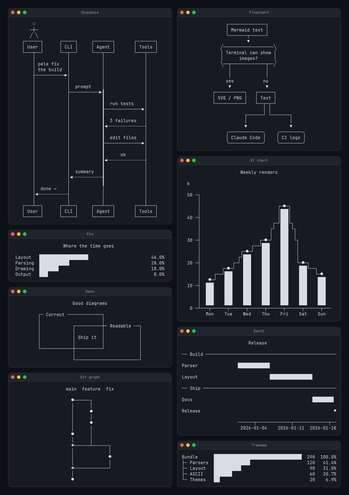

# Pele, drawn as text

Mermaid diagrams for the terminal. `pele/ascii` takes the same Mermaid source as [pele](https://github.com/obsidianmd/pele) and draws it with box-drawing characters, for terminals that cannot show images.

<p align="center"></p>

## Every diagram type

All 32 types pele renders to SVG draw as text. Each links to an example in the [gallery](GALLERY.md).

|  |  |  |  |
| --- | --- | --- | --- |
| [Agent flow](GALLERY.md#agent-flow) | [Architecture](GALLERY.md#architecture) | [Block](GALLERY.md#block) | [C4](GALLERY.md#c4) |
| [Class](GALLERY.md#class) | [Cynefin](GALLERY.md#cynefin) | [Entity relationship](GALLERY.md#entity-relationship) | [Event modeling](GALLERY.md#event-modeling) |
| [Flowchart](GALLERY.md#flowchart) | [Gantt](GALLERY.md#gantt) | [Git graph](GALLERY.md#git-graph) | [Ishikawa](GALLERY.md#ishikawa) |
| [User journey](GALLERY.md#user-journey) | [Kanban](GALLERY.md#kanban) | [Mindmap](GALLERY.md#mindmap) | [Packet](GALLERY.md#packet) |
| [Pie](GALLERY.md#pie) | [Quadrant chart](GALLERY.md#quadrant-chart) | [Radar](GALLERY.md#radar) | [Railroad](GALLERY.md#railroad) |
| [Requirement](GALLERY.md#requirement) | [Sankey](GALLERY.md#sankey) | [Sequence](GALLERY.md#sequence) | [State](GALLERY.md#state) |
| [Swimlane](GALLERY.md#swimlane) | [Timeline](GALLERY.md#timeline) | [Treemap](GALLERY.md#treemap) | [Tree view](GALLERY.md#tree-view) |
| [Use case](GALLERY.md#use-case) | [Venn](GALLERY.md#venn) | [Wardley map](GALLERY.md#wardley-map) | [XY chart](GALLERY.md#xy-chart) |

## Install

Install from a [release](https://github.com/what1f/pele/releases):

```sh
pnpm add https://github.com/what1f/pele/releases/download/1.13.0-ascii.1/pele.tgz
```

## Use

```ts
import { renderAscii } from 'pele/ascii';

const { text } = renderAscii(source, { maxWidth: process.stdout.columns });
console.log(text);
```

| Option | Default | What it does |
| --- | --- | --- |
| `maxWidth` | none | Columns available. A drawing that is too wide is laid out tighter first; if it still does not fit, `renderAscii` throws an `AsciiError` with `code: 'too-wide'`. |
| `charset` | `'unicode'` | `'ascii'` draws lines with `+ - \|` only. |
| `config` | none | Mermaid config, as in `render`. |

The result has `text`, `lines`, `width` and `height` in terminal columns and rows.

Wide characters such as CJK count as two columns, so labels line up:

```
                                      ╭────────╮
┌──────┐            ┌──────────┐      ├────────┤
│ 用户 ├─── 下单 ──▶│ 订单服务 ├─────▶│ 数据库 │
└──────┘            └──────────┘      ╰────────╯
```

`charset: 'ascii'` draws the same layout for terminals and logs without Unicode:

```
                 /---------\
+---------+      | Images? |            +-----+
| Mermaid +----->|         +-+-- yes -->| SVG |
+---------+      \---------/ |          +-----+
                             |
                             |          +------+
                             +-- no --->| Text |
                                        +------+
```

`pele/ascii` also exports `render`, so a program that wants both SVG and text bundles one parser.

[ASCII.md](ASCII.md) describes how the text renderer is built. `npm run build && python3 scripts/ascii-poster.py` redraws the poster above.

## Used by

[mermaid-tui](https://github.com/what1f/mermaid-tui) draws Mermaid diagrams in coding agent terminals, as images where the terminal can show them and as text elsewhere.

## Upstream

Pele renders Mermaid to SVG: small, synchronous, no runtime dependencies, themed with CSS variables. This fork keeps all of it; `import { render } from 'pele'` works as upstream documents. For SVG rendering, theming, security and the playground, see [pele.run](https://pele.run) and [obsidianmd/pele](https://github.com/obsidianmd/pele).

## Develop

```sh
npm install
npm test
npm run build
```

See [Contributing](CONTRIBUTING.md) for parser testing, and [upstream](https://github.com/obsidianmd/pele#develop) for benchmarks and the website.

## License

MIT. The specs under `tests/compat` and the grammar files beside them come from Mermaid, which is also MIT licensed.
